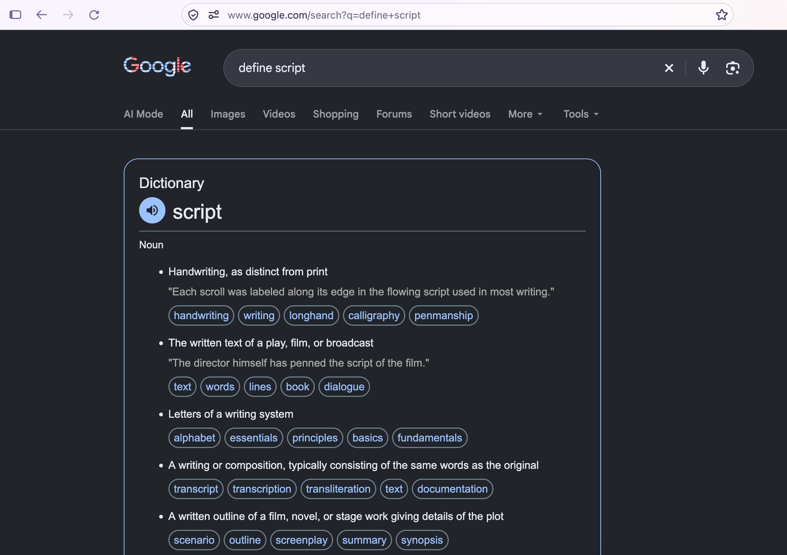
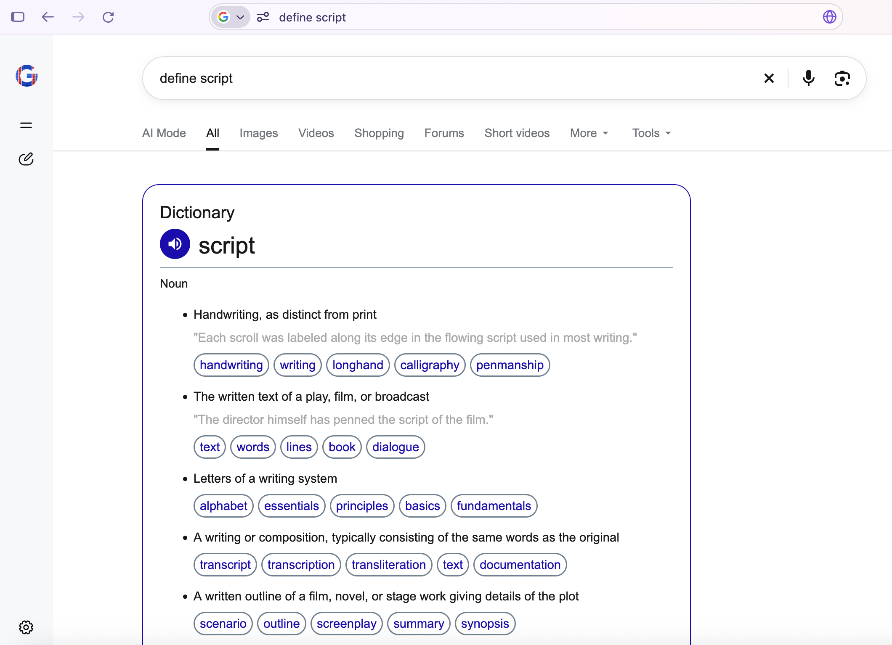
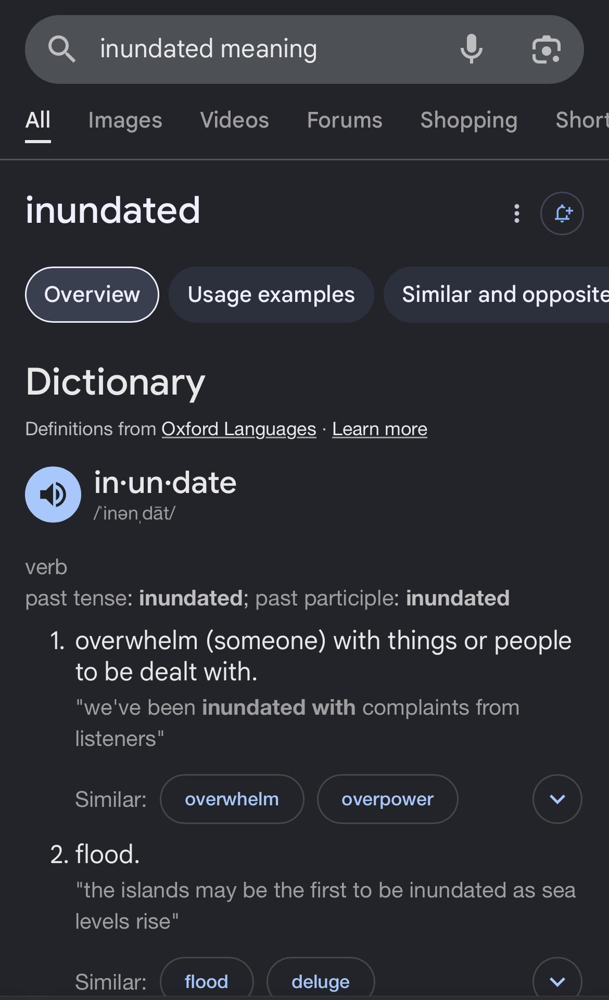

This is a userscript that activates when you search google and checks if your query is shorter or equal to 3 words AND contains "def", "define", "synonyms", "definition", or "meaning". If it passes those checks, the script will attempt to delete the AI Overview, query [Wordhippo](https://www.wordhippo.com) for word information, and inject a div structured similarly to the old dictionary card designs—with a few changes.

### Currently, it has only been tested with Firefox. To run it,
1. Make sure you have a compatible userscript manager. If you don't have one of those, try one of the following:
- [Violentmonkey](https://addons.mozilla.org/en-US/firefox/addon/violentmonkey/)
- [Tampermonkey](https://addons.mozilla.org/en-US/firefox/addon/tampermonkey/) (not tested)
- [Greasemonkey](https://addons.mozilla.org/en-US/firefox/addon/greasemonkey/) (not tested)
2. Find the project on [Greasyfork](https://greasyfork.org/en/scripts/604843-forcedict) and click "Install this script".
3. Confirm if necessary.
4. Find your userscript manager's preferences page by clicking the puzzle icon in the top-right corner and navigating to it. Make sure it's enabled.
5. Test it out by going to https://www.google.com/search?q=define+script. Make sure the div pops up.

### Showcase

Old Google dictionary card example

## TODO

- add the expansion buttons
- style
  - style expansion buttons once i add them
  - resolve comments
- clean up (console.log statements, comments)
- run through code make sure theres no mistakes
- fix the script not fucking activating until reload. this one might be impossible - i don't know whether this is my fault, firefox's, or my userscript manager's.

## TODO Eventually

- add autocorrect (i can do this by reading the searchbar's textcontent - hacky, user might have to click sometimes - or by like querying wordhippo or something. even if theres a free autocorrect api idk if i want to decentralize my program that much. in summary not gonna try it for now.)
- maybe i can somehow force `&udm=web` when I detect the query parameters, but I doubt it will happen. I could make the user change their default search engine, but that is cumbersome and would eliminate the AI completely, which they may not want.
- add tags (this isn't useful enough for me to add it right now.)
  -vulgar
  -offensive
  -informal
  -slang
  -dated
  -often offensive
  -rare
- add IPA text (probably not gonna happen. it will either make the program slower or force it to rely on more stuff)
- add word forms (not gonna try it for now. how useful is it really??)

P.S. I screwed up the the commits so they're all on the same day.